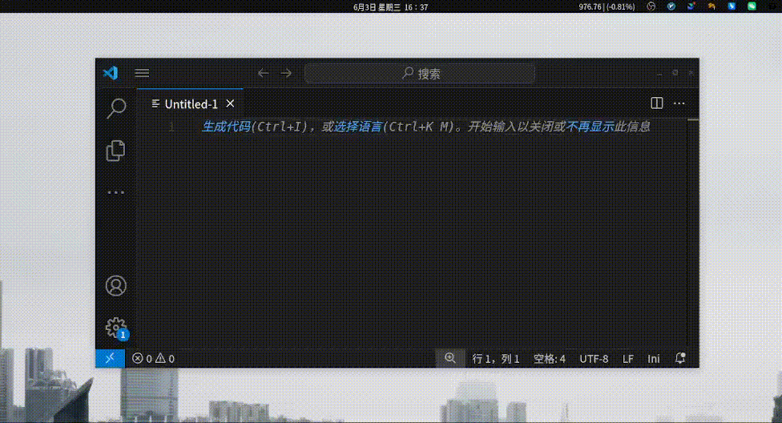

# Linux Voice Input

面向 Ubuntu / X11 桌面的轻量语音输入工具。按一次快捷键开始录音，再按一次停止并识别，识别结果自动粘贴到当前光标所在的输入框。

- **不与输入法冲突**：识别结果通过「写入剪贴板 + 模拟 `Ctrl+V`」上屏，既不注入也不注册为输入法框架，因此与 ibus / fcitx 等中文输入法完全兼容、互不干扰，可与现有输入习惯并存。
- **本地优先**：默认使用本地 SenseVoice 模型，完全离线，识别 + 标点一步到位。
- **两种触发方式**：Ubuntu 自定义快捷键（`--record`）或常驻守护进程（`--daemon`，自带全局热键 + 系统托盘）。
- **三种识别引擎**：本地 SenseVoice（默认）、本地 sherpa 三模型 pipeline、在线 whisper API，可按需切换。




---

## 目录

- [特性](#特性)
- [识别引擎](#识别引擎)
- [快速开始](#快速开始)
- [使用方式](#使用方式)
  - [命令行](#命令行)
  - [图形界面（守护进程 + 托盘）](#图形界面守护进程--托盘)
  - [Ubuntu 快捷键](#ubuntu-快捷键)
- [配置](#配置)
  - [本地语音输入统计](#本地语音输入统计)
- [排查问题](#排查问题)
- [其他](#其他)

---

## 特性

- 🎙️ **一键录音识别**：按一次开始、再按一次结束，结果直接粘贴到当前输入框。
- 🧠 **本地离线识别**：默认 SenseVoice 单模型，识别 + 标点一体，无需联网、不上传音频。
- ⚡ **实时预览**：录音过程中通过桌面通知实时显示识别文字。
- 🖥️ **系统托盘控制**：守护进程模式下常驻后台，模型只加载一次，常用开关即时生效。
- 🔌 **可切换引擎**：本地 SenseVoice / 本地 sherpa / 在线 whisper，按需选择。
- 📦 **一键下载模型**：内置 `--download-models`，带下载进度和速度显示。
- 🩺 **配置自检**：`--check-config` 一键检查环境依赖与模型是否就绪。
- ✍️ **本地中文纠错**：可选 INT8 MacBERT/MDCSpell 模型 + 用户词典，最终粘贴前离线纠错，托盘即时开关。
- 📊 **本地使用统计**：可选记录成功输入的匿名日汇总、字数、录音/端到端耗时和自动纠错数据，不保存输入文本。

---

## 识别引擎

| 引擎 | 类型 | 模型数 | 标点 | 联网 | 说明 |
| --- | --- | --- | --- | --- | --- |
| **sensevoice**（默认） | 本地 | 1 | 内置（ITN） | 否 | 单模型完成识别 + 标点，最省内存，支持中/粤/英/日/韩 |
| **sherpa** | 本地 | 3 | 独立模型 | 否 | 流式预览 + 离线精确识别 + 标点恢复三段式 |
| **whisper** | 在线 | — | 服务端 | 是 | 调用 SiliconFlow API，需要 API Key |

### SenseVoice（默认，推荐）

单个非自回归模型一次前向即输出带标点的识别文本。由于没有原生流式能力，录音过程中的实时预览通过「每隔一段时间（默认 1 秒）对已录音频重跑一次识别」实现，预览与最终结果来自同一模型，天然一致。

```text
录音中：定时重跑 SenseVoice → 通知显示实时预览
    ↓ 停止录音
对完整音频跑一次 SenseVoice（识别 + 标点）
    ↓
可选中文纠错（BERT MLM → 用户词典）
    ↓
剪贴板 + Ctrl+V 粘贴
```

### sherpa（三模型 pipeline）

| 阶段 | 模型 | 作用 |
| --- | --- | --- |
| 实时预览 | Streaming Paraformer | 录音中实时显示部分识别结果 |
| 精确识别 | Paraformer-large（离线） | 停止后对完整音频做高准确率识别 |
| 标点恢复 | CT-Transformer | 对识别结果添加标点符号 |

### whisper（在线）

停止录音后把音频上传到 SiliconFlow API 识别。需要在配置中填写 API Key，需要联网。

---

## 快速开始

### 1. 安装系统依赖

Ubuntu / Debian：

```bash
sudo apt install -y \
  portaudio19-dev \
  xdotool
```

| 依赖 | 用途 |
| --- | --- |
| `portaudio19-dev` | 麦克风录音（编译时需要） |
| `xdotool` | 获取 / 激活窗口并模拟 `Ctrl+V` |

X11 剪贴板读写由程序通过 Go 的 `xgb` 依赖直接完成，不需要安装 `xclip`。

桌面通知直接通过会话总线的 freedesktop `org.freedesktop.Notifications` D-Bus 接口发送，无需 `gdbus`，兼容 GNOME / KDE / XFCE / dunst 等任意符合规范的通知服务。若会话总线不可用，会退化到 `notify-send`（来自 `libnotify-bin`）作为可选兜底，需要时再安装即可：

```bash
sudo apt install -y libnotify-bin
```

> 当前优先支持 **X11**。Wayland 下 X11 剪贴板和 `xdotool` 不可用，建议使用 X11 会话。

### 2. 构建

需要 Go 1.22+ 与 CGO（sherpa-onnx 的 C 共享库通过 Go 模块自动引入）。

```bash
git clone <this-repo>
cd linux-voice-input
go build -o linux-voice-input .
```

或使用 Makefile：

```bash
make build        # 编译二进制到当前目录
```

#### 安装到用户目录（可选）

`make install` 会编译、组装一个自包含目录（二进制 + 运行库），再调用分发包里的 `install.sh` 装到当前用户的 XDG 目录（无需 sudo）。本机安装与[分发到其他机器](#打包分发给其他机器自包含)走的是**同一套脚本**，行为一致：

```bash
make install
```

- 应用目录（二进制 + `lib/*.so`）→ `~/.local/share/linux-voice-input/`
- 命令链接 → `~/.local/bin/linux-voice-input`（软链到上面的二进制）
- 图标 → `~/.local/share/icons/hicolor/512x512/apps/linux-voice-input.png`
- 桌面项 → `~/.local/share/applications/linux-voice-input.desktop`

> 与直接把二进制丢进 `bin/` 不同，这里把二进制连同它的运行库 `.so` 一起装进独立的应用目录，再用软链接暴露到 `PATH`。这样即使之后清理了 Go 模块缓存（`go clean -modcache`），已安装的应用仍能正常启动。

安装后可在应用菜单中搜索 “Linux Voice Input” 直接点击启动（以 `--daemon` 守护进程模式运行，自带托盘和全局热键）。若要卸载：

```bash
make uninstall
```

> 想装到系统级路径可传入 `PREFIX`，例如 `sudo make install PREFIX=/usr/local`（卸载需用相同的 `PREFIX`）。若 `~/.local/bin` 不在 `PATH` 中，命令行调用请先将其加入 `PATH`。

#### 打包分发给其他机器（自包含）

本地引擎依赖 sherpa-onnx 的 C 共享库（`libsherpa-onnx-c-api.so`、`libonnxruntime.so`）。在本机开发时，这些 `.so` 通过 Go 模块自动引入、由链接时写入的 rpath 指向模块缓存，因此 `go build` 出来的二进制直接可跑。但若把二进制单独拷到**没有 Go 环境**的其他机器，它会因找不到这些 `.so` 而无法启动。

`make bundle` 会生成一个自包含、可直接拷走的目录（及对应压缩包），把二进制、所需 `.so`、图标以及安装脚本一起打包：

```bash
make bundle
```

产物：

- 目录 `dist/linux-voice-input/`，含二进制、同级 `lib/*.so`、`icon.png`、`install.sh`、`uninstall.sh`
- 压缩包 `dist/linux-voice-input-linux-x64.tar.gz`

二进制在构建时额外写入了 `$ORIGIN/lib` 相对 rpath，因此会优先加载同目录下 `lib/` 里的 `.so`。把压缩包拷到任意 x86_64 Linux 机器上，**目标机器无需 Go、无需 make、无需系统级安装运行库**。

**方式一：安装为本地应用（推荐）**

解压后进入目录运行内置的 `install.sh`，它会把应用装到用户目录并在应用菜单中注册：

```bash
tar xzf linux-voice-input-linux-x64.tar.gz
cd linux-voice-input
./install.sh                              # 每用户安装到 ~/.local（无需 sudo）
# 或系统级安装：
sudo ./install.sh --prefix /usr/local
```

安装内容：

- 应用目录（二进制 + `lib/`）→ `<prefix>/share/linux-voice-input/`
- 命令链接 → `<prefix>/bin/linux-voice-input`（软链，`$ORIGIN` 按真实路径解析，仍能找到运行库）
- 图标 → `<prefix>/share/icons/hicolor/512x512/apps/`
- 桌面项 → `<prefix>/share/applications/`（用绝对路径以 `--daemon` 启动）

安装后可在应用菜单搜索 “Linux Voice Input” 点击启动，或在终端运行 `linux-voice-input --daemon`。卸载运行同目录的 `./uninstall.sh`（与安装用相同的 `--prefix`），它保留 `~/.linux-voice-input` 下的配置与模型。

**方式二：免安装，直接运行**

```bash
tar xzf linux-voice-input-linux-x64.tar.gz
./linux-voice-input/linux-voice-input --daemon
```

> `make bundle` 里的 `.so` 直接取自 Go 模块缓存，与二进制链接的版本严格一致（版本由 `go.mod` 里的 `sherpa-onnx-go-linux` 决定），无需联网。

#### 手动补齐运行库（缺 `.so` 时）

如果一个二进制启动时报 `error while loading shared libraries: libsherpa-onnx-c-api.so: cannot open shared object file`，说明运行库缺失。有两种补法：

- **让程序自动下载**：`./linux-voice-input --download-models` 在下载模型的同时，会把运行库下载并解压到二进制同目录的 `lib/`（前提是二进制本身还能启动，例如开发构建）。
- **手动下载放置**：从官方 Release 下载对应版本的共享库包（版本需与 `go.mod` 中的 `sherpa-onnx-go-linux` 一致，当前为 v1.13.4），解压后把 `lib/` 下的 `.so` 放到二进制同目录的 `lib/` 里：

```bash
curl -fLO https://github.com/k2-fsa/sherpa-onnx/releases/download/v1.13.4/sherpa-onnx-v1.13.4-linux-x64-shared-lib.tar.bz2
tar xjf sherpa-onnx-v1.13.4-linux-x64-shared-lib.tar.bz2
mkdir -p lib && cp sherpa-onnx-v1.13.4-linux-x64-shared-lib/lib/*.so lib/
```

放好后运行 `./linux-voice-input --check-config`，「sherpa-onnx 库」一项应显示为就绪，并列出实际解析到的目录。

### 3. 下载模型

程序内置下载命令，会下载当前配置需要的识别模型；如果已经启用神经纠错，还会自动下载当前 `corrections.strategy` 选择的纠错模型，并显示进度与速度：

```bash
./linux-voice-input --download-models
```

默认引擎为 sensevoice，只需下载一个识别模型（约 155 MB，为去掉冗余文件后重新打包的精简 int8 模型）。若切换到 sherpa 引擎，再次运行该命令会下载 sherpa 所需的三个模型。启用纠错后，会额外下载当前选择的约 100 MB 压缩模型包到 `~/.linux-voice-input/models/correction/`。

> whisper 引擎本身无需本地识别模型；但如果启用了神经纠错，仍会下载所选的本地纠错模型。

#### 通过代理下载

模型托管在 GitHub Release，国内网络访问可能超时。下载器使用 Go 标准 HTTP 客户端，会自动读取代理环境变量，因此设置对应变量即可走代理：

```bash
# socks5 代理（如 127.0.0.1:10808）
ALL_PROXY=socks5://127.0.0.1:10808 ./linux-voice-input --download-models

# http 代理
HTTPS_PROXY=http://127.0.0.1:7890 ./linux-voice-input --download-models
```

> 若本地 DNS 也被污染导致域名解析失败，socks5 代理可改用 `socks5h://`（让代理端解析域名）：`ALL_PROXY=socks5h://127.0.0.1:10808`。
>
> 注意：`proxychains` 对本程序无效——Go 直接走系统调用建立连接，绕过了 `proxychains` 依赖的 libc 劫持，所以请使用上面的环境变量方式。

### 4. 验证与运行

检查环境依赖和模型是否就绪：

```bash
./linux-voice-input --check-config
```

录音 3 秒做一次识别，验证整条链路：

```bash
./linux-voice-input --test
```

一切正常后，即可通过 [Ubuntu 快捷键](#ubuntu-快捷键) 或 [守护进程](#图形界面守护进程--托盘) 使用。

---

## 使用方式

### 命令行

```text
linux-voice-input [选项]

选项:
  --record           触发录音开关：有守护进程则转发给它，否则独立运行一次
  --daemon           以常驻守护进程运行（系统托盘 + 全局热键；编辑配置后可从托盘重载）
  --test             测试模式：录音 3 秒并识别，用于验证配置是否正确
  --download-models  下载当前配置所需的识别模型、纠错模型与运行库
  --check-config     检查配置与环境依赖，并打印报告
  --stats            查看统计；可附加 --days N 或 --month YYYY-MM
  -v, --version      显示版本号
  -h, --help         显示本帮助信息（无参数时默认显示）
```

> 从 v0.1.0 起，无参数运行会显示帮助信息；触发录音请使用 `--record`（Ubuntu 快捷键也应绑定到 `--record`）。

统计查询示例：

```bash
linux-voice-input --stats                    # 今日、最近 7/30 天、全部累计
linux-voice-input --stats --days 30          # 最近 30 个本地自然日
linux-voice-input --stats --month 2026-08    # 指定月份
```

`--download-models` 输出示例（先下模型，再补运行库到二进制同目录的 `lib/`）：

```text
模型目录: /home/user/.linux-voice-input/models
开始下载: SenseVoice (识别+标点)
下载中: 45.3/154.8 MB (29.3%) 3.2 MB/s
完成: SenseVoice (识别+标点)
全部模型就绪
运行库目录: /path/to/lib
开始下载: sherpa-onnx 运行库
下载中: 9.1/9.1 MB (100.0%) 4.5 MB/s
完成: sherpa-onnx 运行库（/path/to/lib）
```

`--check-config` 输出示例：

```text
配置与环境检查:
  [✓] 显示服务器: X11
  [✓] xdotool: /usr/bin/xdotool
  [✓] 桌面通知: D-Bus 通知服务可用
  [✓] 配置文件: /home/user/.linux-voice-input/config.yaml
  [✓] sherpa-onnx 库: 全部就绪（/home/user/go/pkg/mod/github.com/k2-fsa/sherpa-onnx-go-linux@v1.13.4/lib/x86_64-unknown-linux-gnu）
  [✓] SenseVoice 模型: 全部就绪（/home/user/.linux-voice-input/models）

全部检查通过。
```

### 图形界面（守护进程 + 托盘）

用 `--daemon` 启动常驻后台进程：

```bash
./linux-voice-input --daemon
```

启动后：

- 模型只加载一次并常驻复用，触发识别更快。
- 注册全局热键（默认 `alt+shift+g`），按一次开始录音、再按一次停止并输入。
- 系统托盘菜单：
  - **状态显示**（空闲 / 录音中…）
  - **启用热键监听**（勾选切换，立即生效并保存）
  - **启用语音纠错**（勾选切换，立即生效并保存，不重载 ASR）
  - **启用语音统计 / 查看语音统计**（匿名日汇总；查看今日与最近 30 天）
  - **sensevoice / sherpa / whisper**（选择识别引擎）
  - **下载模型 / 环境检查**
  - **打开配置目录 / 重载配置**
  - **退出**

更细的模型目录、API Key、热键、通知、纠错和统计参数通过 `~/.linux-voice-input/config.yaml` 配置；保存后点托盘“重载配置”生效。

> **GNOME 托盘图标不显示？** GNOME 默认不显示系统托盘，安装并启用 AppIndicator 扩展：
>
> ```bash
> sudo apt install -y gnome-shell-extension-appindicator
> ```
>
> 安装后在 GNOME「扩展」中启用 “AppIndicator and KStatusNotifierItem Support”，然后重新登录。

### Ubuntu 快捷键

打开 `Settings → Keyboard → Keyboard Shortcuts → Custom Shortcuts`，添加：

- **Name**：`Linux Voice Input`
- **Command**：`/path/to/linux-voice-input --record`
- **Shortcut**：例如 `Alt+Shift+G`

使用方式：

1. 把光标放到目标输入框。
2. 按一次快捷键开始录音。
3. 再按一次快捷键停止录音并自动输入。

`--record` 运行时，程序会先探测是否有守护进程在跑：

- **有**：把 toggle 转发给守护进程，复用已加载的模型（快），随即退出。
- **没有**：退化为独立的一次性进程，加载模型 → 录音 → 识别 → 粘贴 → 退出。

因此快捷键方式与守护进程方式可以并存：开了守护进程后，原有的 Ubuntu 快捷键会自动通过 socket 转发给它而变快，无需任何改动。

---

## 配置

首次运行会自动在下面路径创建配置文件（含所有默认值）：

```text
~/.linux-voice-input/config.yaml
```

顶层的 `engine` 字段选择识别引擎，下面每个引擎各有一个同名配置块。通常你只需要改 `engine` 一行，其余保持默认即可（本地引擎的模型路径会自动从模型目录推导）。

### 默认配置（sensevoice）

```yaml
engine: sensevoice          # 识别引擎：sensevoice / sherpa / whisper

sensevoice:
  model_dir: /home/<user>/.linux-voice-input/models
  language: auto            # auto / zh / en / yue / ja / ko
  use_itn: true             # 开启逆文本正则化（含标点）
  num_threads: 4
  preview_interval_ms: 1000 # 实时预览重跑间隔（毫秒）；填 0 关闭预览

audio:
  sample_rate: 16000
corrections:
  enabled: false                    # 可在托盘“启用语音纠错”即时切换
  strategy: macbert-mdcspell-v2     # macbert-mdcspell-v2 / macbert4csc；留空为纯词典
  model_dir: /home/<user>/.linux-voice-input/models/correction
  runtime_path: ""                  # 通常留空，复用应用自带 libonnxruntime
  confidence_threshold: 0.9         # 高阈值优先避免误改
  min_margin: 0.2
  max_length: 128
  timeout_ms: 1500
  num_threads: 4
  dict_path: ""                     # 留空则用 ~/.linux-voice-input/corrections.txt
statistics:
  enabled: false                    # 可在托盘“启用语音统计”即时切换
hotkey: alt+shift+g
hotkey_enabled: true
restore_clipboard: true
remove_trailing_symbols: true       # 去掉识别结果末尾的标点与空格，默认开启
```

### 切换到 sherpa

```yaml
engine: sherpa

sherpa:
  model_dir: /home/<user>/.linux-voice-input/models
  num_threads: 4
  rule1_min_trailing_silence: 2.4  # 较长静音后结束一段话（秒）
  rule2_min_trailing_silence: 1.2  # 较短静音后结束一段话（秒）
```

### 切换到 whisper（在线）

```yaml
engine: whisper

whisper:
  key: sk-xxxxxxxx
  base_url: https://api.siliconflow.cn/v1
  model: FunAudioLLM/SenseVoiceSmall
```

### 主要配置字段

| 字段 | 说明 |
| --- | --- |
| `engine` | 识别引擎：`sensevoice`（默认）/ `sherpa` / `whisper` |
| `sensevoice.model_dir` | SenseVoice 模型所在目录（`model`/`tokens` 路径由它自动推导） |
| `sensevoice.language` | 识别语种：`auto` / `zh` / `en` / `yue` / `ja` / `ko` |
| `sensevoice.use_itn` | 是否开启逆文本正则化（含标点），默认 `true` |
| `sensevoice.num_threads` | 推理线程数，默认 4 |
| `sensevoice.preview_interval_ms` | 实时预览重跑间隔（毫秒）；`> 0` 开启，`0` 或负数关闭 |
| `sherpa.model_dir` | sherpa 三模型所在目录（各模型路径由它自动推导） |
| `sherpa.num_threads` | 推理线程数，默认 4 |
| `sherpa.rule1_min_trailing_silence` | 较长静音断句阈值（秒），默认 2.4 |
| `sherpa.rule2_min_trailing_silence` | 较短静音断句阈值（秒），默认 1.2 |
| `whisper.key` | SiliconFlow API Key，whisper 引擎必填 |
| `whisper.base_url` | API 地址 |
| `whisper.model` | 在线识别模型，默认 `FunAudioLLM/SenseVoiceSmall` |
| `audio.sample_rate` | 录音采样率，默认 16000 |
| `hotkey` | 守护进程全局热键，如 `alt+shift+g`（修饰键：ctrl/alt/shift/super） |
| `hotkey_enabled` | 守护进程启动时是否启用全局热键监听 |
| `corrections.enabled` | 是否开启最终文本纠错（神经模型 + 用户词典），默认 `false`；托盘可即时切换 |
| `corrections.strategy` | 神经模型：`macbert-mdcspell-v2`（默认）/ `macbert4csc`；空值表示纯词典 |
| `corrections.model_dir` | 纠错模型根目录，默认 `~/.linux-voice-input/models/correction` |
| `corrections.runtime_path` | ONNX Runtime 动态库；通常留空，自动复用应用自带运行库 |
| `corrections.confidence_threshold` | 候选字最低概率，默认 `0.9` |
| `corrections.min_margin` | 候选字相对原字概率的最低增量，默认 `0.2` |
| `corrections.max_length` | 单次模型最多处理的 BERT token 数，默认 128；超出部分保持原文 |
| `corrections.timeout_ms` | 单次最终纠错软超时，默认 1500ms |
| `corrections.num_threads` | 纠错模型 CPU 推理线程数，默认 4 |
| `corrections.dict_path` | 最后执行的用户词典路径；留空则用 `~/.linux-voice-input/corrections.txt` |
| `statistics.enabled` | 是否记录成功语音输入的匿名日汇总，默认 `false`；关闭只暂停新增，历史数据保留 |
| `restore_clipboard` | 粘贴后是否尽量恢复原剪贴板内容；旧剪贴板无法完整读取时仍会优先输入识别文字 |
| `remove_trailing_symbols` | 是否去掉识别结果末尾的标点、符号与空格（不影响句中标点），默认 `true`；需要末尾符号或空格时请自行补充 |

> **旧配置自动迁移**：如果你的 `config.yaml` 还是旧的 `api:` 块格式（`api.engine` / `api.key` 等），程序会在加载时自动迁移到新的 `engine` + `whisper` 布局并回写，无需手动改动。

### 本地语音输入统计

统计开启后，只有成功执行 `Ctrl+V` 的语音输入会被计入；取消、过短、空结果、识别失败、粘贴失败和 `--test` 均不统计。统计日文件不会保存识别文本、纠错后文本或逐次输入记录（运行日志仍遵循现有行为）。

每个本地自然日写入一个 JSON 文件，并按年月分目录：

```text
~/.linux-voice-input/stats/YYYY/MM/DD.json
```

例如 `~/.linux-voice-input/stats/2026/08/26.json`。每个文件包含当天总计和按识别引擎汇总，主要字段为：

| 字段 | 口径 |
| --- | --- |
| `successful_inputs` | 成功粘贴次数 |
| `characters` | 排除 Unicode 空白后的 rune 数；标点和 emoji 也计入 |
| `han_characters` | 其中属于 Unicode Han 字符集的汉字数 |
| `recording_duration_ms` | 开始录音到用户停止录音的累计毫秒数 |
| `input_duration_ms` | 开始录音到文字实际注入窗口的累计毫秒数，包含识别和纠错，不含剪贴板恢复等待 |
| `corrected_inputs` | 最终文本被内置模型或用户词典改变的输入次数 |
| `correction_edits` | 纠错前后文本的 rune 级 Levenshtein 编辑数 |
| `correction_strategy_inputs` | 每个纠错策略实际产生修改的输入次数 |

日文件是唯一数据源；最近 7/30 天、指定月份和全部累计都在查询时合并，不维护可能与日文件不一致的第二份总计。关闭统计只停止新增文件更新，不删除历史数据。当前只记录客观耗时，不配置传统打字速度，也不计算节省时间，后续分析工具可直接读取这些日文件。

### 本地中文纠错（模型 + 用户词典）

纠错发生在识别引擎完成最终识别之后、粘贴之前，对 sensevoice / sherpa / whisper 都生效：

```text
最终识别文本
  -> 一个 BERT MLM 模型（高置信度、只改单个汉字）
  -> 用户精确词典（最终决定权，可做不等长/英文替换）
  -> 粘贴
```

当前支持两个约 0.1B 参数的模型策略：

| 策略 | 来源 | 本项目 INT8 文件 | 特点 |
| --- | --- | ---: | --- |
| `macbert-mdcspell-v2`（默认） | [Macropodus/macbert4mdcspell_v2](https://huggingface.co/Macropodus/macbert4mdcspell_v2) | 约 114.4 MiB | 本地小样本召回更好、正确句无误改 |
| `macbert4csc` | [shibing624/macbert4csc-base-chinese](https://huggingface.co/shibing624/macbert4csc-base-chinese) | 约 114.4 MiB | 成熟基准模型 |

产品运行只依赖 Go 编译产物和已有 `libonnxruntime`。推荐直接使用内置下载器：先启用纠错并选择策略，再下载当前配置缺少的模型。

```bash
# 配置文件中设置 corrections.enabled: true 和所需 strategy 后：
./linux-voice-input --download-models

# 或在守护进程托盘中：
# 1. 勾选“启用语音纠错”
# 2. 点击“下载模型”

./linux-voice-input --check-config
```

切换模型只需修改配置，然后重载并再次执行下载；下载器只补当前策略缺失的文件：

```yaml
corrections:
  enabled: true
  strategy: macbert4csc  # 或 macbert-mdcspell-v2
```

Python/PyTorch 不再是安装模型的必需依赖。开发者如需从上游 checkpoint 重新导出、量化或复现实验，才运行：

```bash
python3 -m pip install -r scripts/correction/requirements.txt

# 默认准备两个模型到 ~/.linux-voice-input/models/correction
python3 scripts/correction/prepare_models.py

# 也可只准备默认模型
python3 scripts/correction/prepare_models.py --models macbert-mdcspell-v2
```

准备好模型后，守护进程托盘勾选 **“启用语音纠错”** 即时生效，不会重载 SenseVoice。也可以编辑 `corrections.enabled` 后点击托盘“重载配置”。模型首次使用会懒加载，之后保持常驻；模型缺失或推理失败时原文透传，用户词典仍会继续执行。

#### 本地模型评测

评测命令支持一句话、标准输入多行和 JSONL case 文件：

```bash
# 一句话，同时比较两个模型
go run ./cmd/correction-eval --text '我门已经部属完成'

# 多句话
printf '%s\n' '我门需要提高工作效率' '今天的天气很好' \
  | go run ./cmd/correction-eval

# 带 expected 的可重复评测
go run ./cmd/correction-eval --cases docs/correction-eval.example.jsonl
```

当前机器用默认阈值 `0.90`、margin `0.20` 对 15 条错句/正确句/歧义句的实测结果：

| 模型 | 完全匹配 | 正确/歧义句误改 | 首次加载 | 加载后单句 |
| --- | ---: | ---: | ---: | ---: |
| MDCSpell-v2 INT8 | 12/15 | 0 | 约 459ms | 约 6–13ms |
| MacBERT4CSC INT8 | 11/15 | 0 | 约 433ms | 约 6–12ms |

这只是工程通路和小样本安全性验证，不替代真实 SenseVoice 错误语料评测。建议把日常遇到的“原始识别/期望文本”持续追加到自己的 JSONL，再决定阈值或模型。

#### 用户词典（纠正专业名词）

本地模型对一些计算机专业名词容易识别错，典型的两类错误是**中文同音词**（把「线程」听成「现成」）和**英文术语被音译成中文**（把 `Redis` 听成「瑞迪斯」）。你可以维护一份纠正词典，程序会在识别完成、粘贴之前对结果做文本替换。它对所有引擎（sensevoice / sherpa / whisper）都生效。

启用步骤：

1. 在托盘勾选“启用语音纠错”，或把 `corrections.enabled` 改成 `true`。
2. 准备词典文件（默认 `~/.linux-voice-input/corrections.txt`），可直接拷仓库里的示例 [`docs/corrections.example.txt`](./docs/corrections.example.txt)：
   ```bash
   cp docs/corrections.example.txt ~/.linux-voice-input/corrections.txt
   ```
3. 保存即生效，**无需重启**——程序检测到词典文件修改时间变化会自动重载。

词典格式，每行一条规则：

```text
# '=' 左边是正确词，右边是可能被识别成的错词，多个错词用逗号分隔（中英文逗号均可）
# 以 # 开头的行是注释，空行忽略

Redis = 瑞迪斯, 瑞迪思
Docker = 道克, 道客
多线程 = 多现成, 多先成
缓存 = 换成
```

匹配规则：从左到右扫描，优先匹配最长的错词；已经替换出的正确词不会被后续规则再次替换（不会连锁触发）。

> ⚠️ **注意误伤**：替换是纯文本匹配，如果某个「错词」在日常语境里也是正常词（如「现成」），就可能改错。建议优先维护英文术语音译这类几乎不会歧义的规则；对有歧义的同音词，尽量用更长的上下文（如用「多现成」而不是「现成」），并小范围试用后再固定下来。

---

## 排查问题

**没有自动输入 / 粘贴失败**

1. 确认当前是 X11 会话（`echo $XDG_SESSION_TYPE`）。
2. 确认已安装 `xdotool`（剪贴板读写已内置，不需要 `xclip`）。
3. 确认活动窗口和模拟按键可用：
   ```bash
   xdotool getactivewindow
   ```
4. 查看日志：`tail -f ~/.linux-voice-input/run.log`。

**识别结果为空**

1. 运行 `./linux-voice-input --check-config` 确认模型就绪。
2. 运行 `./linux-voice-input --test` 验证识别链路。
3. 缺失模型时运行 `./linux-voice-input --download-models`。

**误触发保护**：录音时长小于 1 秒会被忽略，不识别、不粘贴，并提示「录音过短，已忽略」。

---

## 其他

### 桌面通知

本地引擎录音过程中，通知会持续更新显示实时识别文字；最终结果通知会在几秒后自动关闭。常见状态：

- `录音中: <实时识别文字>`
- `已输入：<最终结果>`
- `录音过短，已忽略`
- `识别失败`

通知开关可在设置窗口中逐项配置。

### 日志

```bash
tail -f ~/.linux-voice-input/run.log
```

日志包含配置信息、各阶段处理耗时、识别结果等，自动保留最近 3 天。

### 开机自启（守护进程）

创建 `~/.config/autostart/linux-voice-input.desktop`：

```ini
[Desktop Entry]
Type=Application
Name=Linux Voice Input
Exec=/path/to/linux-voice-input --daemon
X-GNOME-Autostart-enabled=true
```

### 致谢

本地识别基于 [sherpa-onnx](https://github.com/k2-fsa/sherpa-onnx) 与阿里 [FunASR](https://github.com/modelscope/FunASR) 的 SenseVoice / Paraformer / CT-Transformer 模型。
